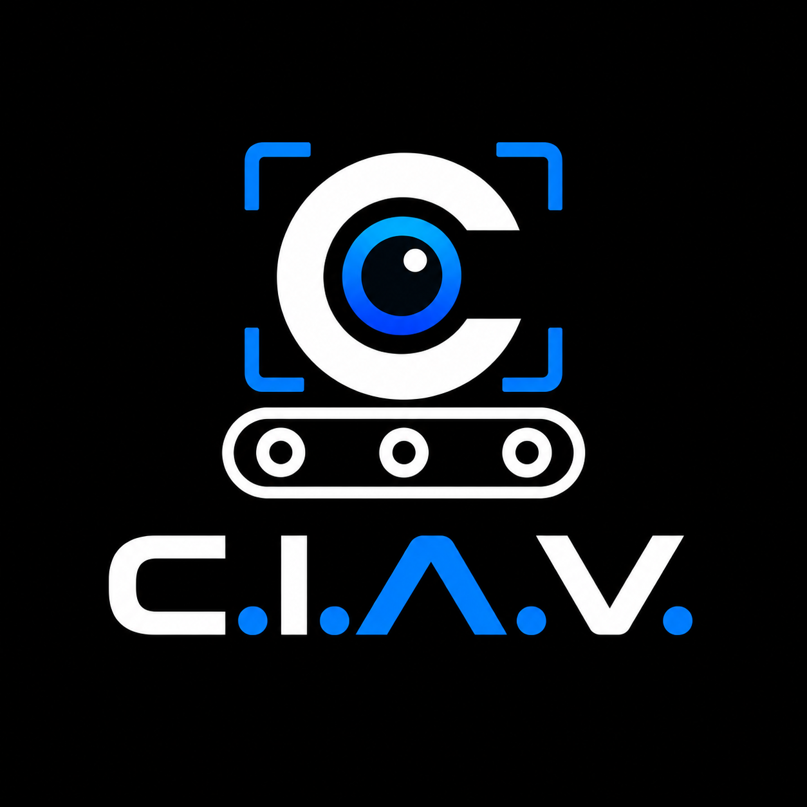
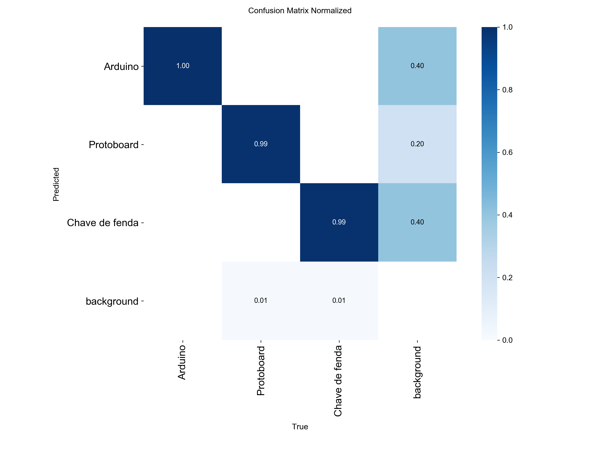
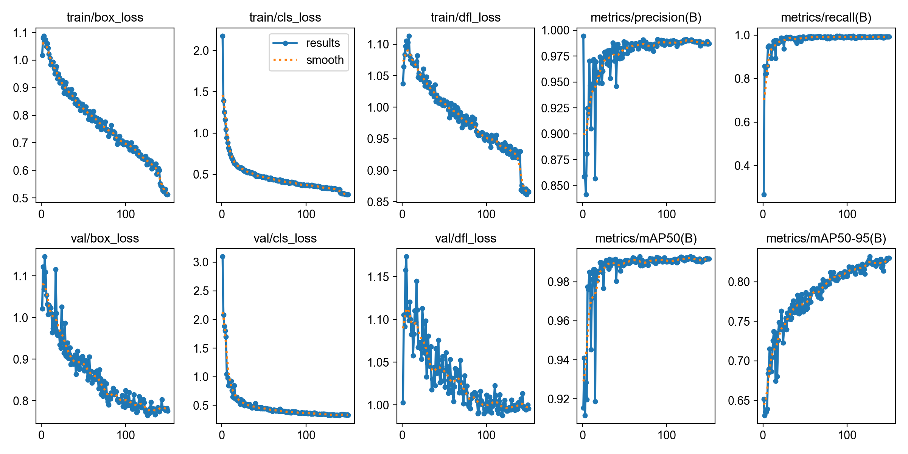

<p align="center">
  
</p>


# Contador de Objetos com YOLOv8 — TCC

Sistema de visão computacional que detecta, rastreia e conta em tempo real três objetos: **Arduino**, **Protoboard** e **Chave de fenda**. As detecções são gravadas em um banco SQLite e exportadas para um relatório em Excel.

> Trabalho de Conclusão de Curso — Automação Industrial, Etec Júlio De Mesquita, 2026
> Autores: Arthur Pavan Andre, Brayan veiga dos Anjos, Gabriel Van-Dal Sant'Ana, Gustavo Jeferson Camillo, João Victor Marcelane, Murilo Ribeiro Postal e Rafael Guerra Caetano ·
> Orientadores: Carlos Rogerio Rossi e Fernando Jose Aldecoa

<!-- Colocar aqui uma imagem ou GIF do sistema funcionando: -->
<!--  -->

## Como funciona

1. A câmera captura os quadros com OpenCV.
2. O modelo YOLOv8n treinado (`best.pt`) detecta os objetos e o rastreador (`model.track`) atribui um ID a cada um.
3. Quando o centro de um objeto passa da linha de contagem, ele é contado uma única vez (por ID). Só são consideradas detecções com confiança ≥ 0,50, com intervalo mínimo de 3 s entre duas contagens.
4. Cada contagem é salva no banco `deteccoes.db` (objeto, confiança e horário).
5. Ao encerrar o programa (tecla **Q**), o relatório `Relatorio.xlsx` é gerado automaticamente.

## Tecnologias

Python · Ultralytics YOLOv8 · OpenCV · SQLite · Pandas / OpenPyXL

## Estrutura do repositório

```
.
├── Geral/
│   ├── main.py             # Sistema principal (câmera, detecção, contagem)
│   ├── banco.py            # Criação do banco e função de salvar detecções
│   ├── gerar_excel.py      # Exporta o banco para Relatorio.xlsx
│   ├── limpar_banco.py     # Apaga as detecções e o relatório antigo
│   ├── train_arduino_v8.py # Treinamento do modelo
│   ├── arduino.yaml        # Configuração do dataset (classes e pastas)
│   ├── txt_vazio.py        # Cria labels vazios para imagens sem objetos
│   ├── split_dataset.py    # Divide o dataset em treino (70%) e validação (30%)
│   ├── ler_txt.py          # Conta quantas imagens existem por classe
│   ├── imgcerta.py         # Procura imagens corrompidas
│   └── modelo/
│       └── best.pt         # Pesos do modelo treinado
├── requirements.txt
└── README.md
```

## Requisitos

- Python 3.10 ou superior
- Webcam
- GPU NVIDIA com CUDA (apenas para **treinar**; a execução funciona em CPU)

## Instalação

```bash
git clone https://github.com/ArthurAPA/TCC.git
cd TCC

python -m venv .venv
# Windows:
.venv\Scripts\activate
# Linux/macOS:
source .venv/bin/activate

pip install -r requirements.txt
```

> Para treinar com GPU, instale o PyTorch com CUDA seguindo as instruções de https://pytorch.org antes do `pip install`.

## Como executar

```bash
cd Geral
python main.py
```

- Pressione **Q** para encerrar. O relatório `Relatorio.xlsx` será gerado na mesma pasta.
- Para apagar as detecções e o relatório antigo: `python limpar_banco.py`.

## Dataset

- 3 classes: `0 Arduino`, `1 Protoboard`, `2 Chave de fenda`
- 880 imagens de treino e 402 de validação, anotadas no formato YOLO
- Download: **COLOCAR AQUI[link do dataset — Drive/Roboflow]**

As imagens não estão neste repositório por conta do tamanho. Depois de baixá-las, edite a linha `path:` do `arduino.yaml` para apontar para a pasta do dataset no seu computador.
As imagens utilizadas como background (utilizadas no treinamento da IA para a mesma não reconhecer qualquer objeto como os 3 desejados) não estarão no dataset por questões de privacidade

## Treinamento (opcional)

Preparação do dataset, nesta ordem:

```bash
python txt_vazio.py       # cria labels vazios para imagens sem objetos
python split_dataset.py   # separa treino e validação
python ler_txt.py         # confere a quantidade de imagens por classe
python train_arduino_v8.py
```

Antes de rodar, ajuste os caminhos no topo de cada script. O treino usa o `yolov8n.pt` como base (baixado automaticamente pelo Ultralytics), 150 épocas, e salva os resultados na pasta `runs/`.

## Resultados

| Métrica | Valor |
|---|---|
| Precisão | [preencher] |
| Recall | [preencher] |
| mAP@50 | [preencher] |
| mAP@50-95 | [preencher] |

## Gráficos

<p align="center">
  
</p>
<p align="center">
  
</p>

## Limitações e próximos passos

- Dashboard no Power BI a partir do relatório em Excel
- [Outras limitações observadas nos testes: iluminação, objetos sobrepostos, etc.]

## Licença

Código distribuído sob a licença MIT (ver `LICENSE`). O projeto usa o [Ultralytics YOLOv8](https://github.com/ultralytics/ultralytics), licenciado sob AGPL-3.0.
